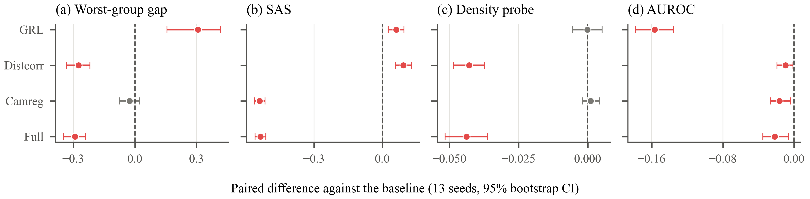

# Decoupling Shortcut Learning Axes in Mammography Classification

Code and results for the ICMLDE 2026 paper (Procedia Computer Science).

A mammography classifier can use breast density as a shortcut for malignancy. This project treats the problem as two separate questions:

- **Feature level:** can density still be predicted from the learned features?
- **Explanation level:** does the Grad-CAM attribution fall on breast tissue, or on the background and image borders?

A known density–malignancy correlation (r ≈ 0.6) is injected into the CBIS-DDSM training split only. Four interventions are then compared over 13 seeds, each paired against a same-seed baseline:

- a gradient-reversal adversary (GRL);
- a distance-correlation penalty, the feature-level fix;
- Grad-CAM regularization with a breast mask, the explanation-level fix;
- both fixes together.

Published methods are compared on the same splits: a MINE penalty, a non-linear adversary, CLUB, Group DRO and JTT. INbreast is used as a second, full-field digital dataset.

## Main result

CBIS-DDSM, mean over 13 seeds. Worst-group gap = AUROC on the aligned group minus AUROC on the conflicting group. SAS = share of Grad-CAM attribution outside the breast.

| Strategy | AUROC | Worst-group gap | SAS |
|---|---|---|---|
| Baseline | 0.705 | 0.357 | 0.557 |
| Distance correlation | 0.696 | 0.083 | 0.650 |
| CAM regularization | 0.689 | 0.331 | 0.018 |
| Both | 0.684 | 0.065 | 0.021 |

Each fix moves only its own axis, and the combination fixes both at a cost of about two AUROC points.



## Repository structure

```
mammography-shortcut-axes/
├── src/                          shared code, imported by the scripts
│   ├── core_pipeline.py          data loading, breast masks, shortcut injection, model, training, evaluation
│   ├── core_pipeline_legacy.py   earlier pipeline version, used by external_validation.py
│   ├── external_validation.py    INbreast loading, DICOM reading and the external-dataset sweep
│   ├── published_baselines.py    MINE, non-linear adversary, Group DRO and JTT
│   ├── experiment_utils.py       splits, single-run training, result storage, paired statistics
│   └── paths.py                  data and output folders
├── experiments/                  scripts that train models
│   ├── main_cbis_ddsm.py
│   ├── method_comparison.py
│   ├── calibration_experiment.py
│   ├── inbreast_validation.py
│   ├── shortcut_strength_sweep.py
│   ├── backbone_density_variants.py
│   ├── weight_and_grl_sweeps.py
│   └── full_weight_grid.py
├── analysis/                     scripts that only read data or saved results
│   ├── density_split_report.py
│   ├── mask_audit.py
│   ├── calibration_analysis.py
│   ├── density_probe_metrics.py
│   ├── tables_and_figures.py
│   └── paper_figures.py
├── data/                         datasets go here (not included)
├── outputs/                      one folder per script; each has a README listing its files
├── requirements.txt
└── README.md
```

## Where each result in the paper comes from

| Paper item | Script | Output folder |
|---|---|---|
| Tables 4–5, Fig. 2 (main comparison, Grad-CAM examples) | `experiments/main_cbis_ddsm.py` | `outputs/main_experiment/` |
| Table 7 (published methods) | `experiments/method_comparison.py` | `outputs/method_comparison/` |
| Tables 2 and 8 (group sizes, calibration), SAS under perturbed masks | `experiments/calibration_experiment.py` + `analysis/calibration_analysis.py` | `outputs/calibration_experiment/` |
| Balanced accuracy and AUROC of the density probe | `analysis/density_probe_metrics.py` | `outputs/calibration_experiment/` |
| Table 6, INbreast row | `experiments/inbreast_validation.py` | `outputs/inbreast_validation/` |
| Table 6, shortcut-strength rows; Fig. 4a | `experiments/shortcut_strength_sweep.py` | `outputs/shortcut_strength_sweep/` |
| Table 6, backbone and density-definition rows | `experiments/backbone_density_variants.py` | `outputs/backbone_density_variants/` |
| Fig. 4b, 4c (loss-weight sweeps), Fig. 5 (GRL settings) | `experiments/weight_and_grl_sweeps.py` | `outputs/distcorr_weight_sweep/`, `camreg_weight_sweep/`, `grl_settings/` |
| Fig. 4d (full-model weight grid) | `experiments/full_weight_grid.py` | `outputs/full_weight_grid/` |
| Section 3.1 (density definition, natural correlation) | `analysis/density_split_report.py` | `outputs/density_split_report/` |
| Section 4.6 (breast-mask audit) | `analysis/mask_audit.py` | `outputs/mask_audit/` |
| Figs. 3, 4 and 5 as printed | `analysis/paper_figures.py` | `outputs/paper_figures/` |

Fig. 1 (study pipeline) was drawn by hand and is included as an image in `outputs/paper_figures/`.

## Setup

Tested with Python 3.11.9 and PyTorch 2.5.1 (CUDA 12.1) on an NVIDIA RTX 4060 Laptop GPU, on Windows.

```
pip install -r requirements.txt
```

Install the PyTorch build that matches your CUDA version from https://pytorch.org.

## Data

The datasets are not part of this repository.

- **CBIS-DDSM** (JPEG version, folder with `csv/` and `jpeg/`): place it in `data/CBIS-DDSM/`. The original collection is on The Cancer Imaging Archive: https://doi.org/10.7937/K9/TCIA.2016.7O02S9CY
- **INbreast** (folder with `AllDICOMs/` and `INbreast.csv` or `.xls`): place it in `data/INbreast/`. INbreast is available from its authors on request.

To use data stored elsewhere, set the environment variables `CBIS_DDSM_DIR` and `INBREAST_DIR`.

## Reproducing the results

Run the scripts from the repository root. The main experiment comes first, because later scripts reuse its results and image cache.

```
python experiments/main_cbis_ddsm.py
python experiments/method_comparison.py
python experiments/calibration_experiment.py
python experiments/inbreast_validation.py --data-root data/INbreast
python experiments/shortcut_strength_sweep.py --seeds 5
python experiments/backbone_density_variants.py --seeds 5
python experiments/weight_and_grl_sweeps.py --study distcorr
python experiments/weight_and_grl_sweeps.py --study camreg
python experiments/weight_and_grl_sweeps.py --study grl
python experiments/full_weight_grid.py

python analysis/density_split_report.py
python analysis/mask_audit.py --full-res
python analysis/calibration_analysis.py calibration --dir outputs/calibration_experiment
python analysis/density_probe_metrics.py --dir outputs/calibration_experiment
python analysis/tables_and_figures.py
python analysis/paper_figures.py
```

`main_cbis_ddsm.py` and `method_comparison.py` accept `--seeds N` (use the first N seeds). The other experiment scripts accept `--help`, `--dry-run` (plan the runs without training) and `--smoke` (a quick run of one seed to check the setup).

## Reproducibility notes

- Seeds 42–54 are used for the 13-seed runs. The first five of them are used for the 5-seed sweeps.
- Training runs with `cudnn.deterministic = True`, `cudnn.benchmark = False` and `CUBLAS_WORKSPACE_CONFIG=:4096:8`.
- One exception: `method_comparison.py` imports `core_pipeline_legacy`, which switches `cudnn.benchmark` back on, so a rerun of that script can differ slightly in the last decimal place.
- Each run writes a `run_manifest*.json` file with the seeds, settings and library versions used.
- Model checkpoints, image caches and INbreast images are excluded by `.gitignore`.


## Acknowledgements

This work was carried out at the Department of Computer Science and Engineering, Amrita School of Computing, Amrita Vishwa Vidyapeetham, Coimbatore. CBIS-DDSM is provided by The Cancer Imaging Archive, and INbreast by its authors (Moreira et al., 2012).
